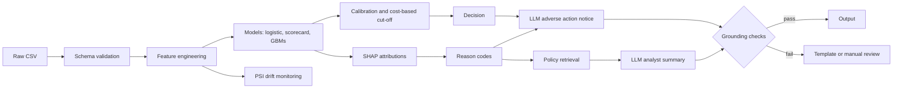

# Credit Risk Modeling: Two-Year Delinquency Prediction

[](https://github.com/sahandyousefi/Predicting-2-Year-Loan-Classification/actions/workflows/ci.yml)


This project estimates the probability that a borrower becomes 90 or more days past due within two years, and turns that estimate into a lending decision that can be explained, monitored and communicated. It started as an exploratory notebook on the Credit Risk Benchmark Dataset and is now a tested Python package with six model families and a stacked ensemble, calibration and cost-based cut-offs, attribution-based reason codes, fairness and drift checks, a scoring API, and an LLM layer that drafts adverse action notices and analyst summaries and reads structured fields from free-text applications, all under strict grounding checks.

## Contents

- [What the project does](#what-the-project-does)
- [Results](#results)
- [Architecture](#architecture)
- [Getting started](#getting-started)
- [Methodology](#methodology)
- [LLM decision support](#llm-decision-support)
- [Serving](#serving)
- [Testing and CI](#testing-and-ci)
- [Limitations](#limitations)
- [References](#references)

## What the project does

| Area | Implementation |
| --- | --- |
| Data | Schema validation with hard errors and soft warnings, synthetic data generator with the same schema for tests |
| Features | Ratio features, a weighted delinquency severity score, log transforms, Weight of Evidence binning with Information Value, dense embeddings of loan-purpose text (LSA or Sentence-BERT) |
| Models | L1 logistic regression, WoE scorecard with points scaling, histogram gradient boosting, XGBoost, LightGBM, optional monotonic constraints on the boosting models, PyTorch MLP with piecewise linear encoding of numerical inputs, non-negative stacked ensemble on out-of-fold predictions, discrete-time hazard model for time to default |
| Tuning | Optuna (TPE) with nested cross-validation to separate selection from evaluation |
| Evaluation | ROC-AUC, Gini, KS, PR-AUC, lift and gain tables, DeLong test, Brier score, ECE, Hosmer-Lemeshow, stratified bootstrap intervals for every reported metric, out-of-time validation by application month |
| Decisions | Profit-maximizing cut-off from PD, LGD, EAD and margin, Mondrian conformal sets with an approve, decline or refer rule, Venn-Abers PD intervals |
| Explainability | Exact linear SHAP and TreeSHAP, reason codes grouped to borrower attributes, PDP and ICE |
| Fairness | Approval rates, disparate impact and equal opportunity difference by age band |
| Monitoring | PSI and characteristic stability, champion-challenger tests with swap-set analysis, run fingerprints, MLflow tracking with a JSON fallback |
| Serving | Batch scoring CLI, FastAPI service with request validation, Dockerfile |
| LLM | Provider-agnostic client, versioned prompts, grounded adverse action notices, retrieval over credit policy, structured field extraction with quote-level grounding, consistency checks against bureau data, evaluation harness, prompt injection screening |

## Results

### Exploration notebook (benchmark data)

`notebooks/01_exploration_and_baseline.ipynb` documents the original analysis. Logistic regression on the raw attributes reached ROC-AUC 0.73. Adding engineered features raised it to 0.835 on the held-out test set:

| Model | Accuracy | Precision | Recall | F1 | ROC-AUC |
| --- | --- | --- | --- | --- | --- |
| Logistic regression, raw features | 0.66 | 0.68 | 0.60 | 0.64 | 0.73 |
| Logistic regression, engineered features | 0.760 | 0.759 | 0.760 | 0.760 | 0.835 |

The notebook fitted the scaler on the full dataset before splitting. The package moves scaling inside the pipeline, so these figures are a reference point rather than the final estimate.

### Package pipeline

Results to be filled from a full run on the benchmark data with `credit-risk train` and `credit-risk compare`. The comparison table reports discrimination, calibration, DeLong p-values against the best model and realized profit at the chosen cut-off.

### Text embedding ablation (synthetic data)

The table below comes from synthetic data only: 5,000 generated borrowers with generated purpose text, 16 LSA components, 5-fold cross-validation repeated twice. It checks that the ablation detects incremental signal when the generator puts it there and finds none when $\gamma = 0$. It says nothing about the value of text on real applications.

| Signal $\gamma$ | Learner | AUC, structured | AUC, structured + text | Gain | Corrected $t$-test p |
| --- | --- | --- | --- | --- | --- |
| 0.0 | Logistic | 0.732 | 0.731 | -0.001 | 0.54 |
| 0.0 | HistGBM | 0.710 | 0.708 | -0.002 | 0.58 |
| 0.5 | Logistic | 0.732 | 0.756 | 0.024 | < 0.001 |
| 0.5 | HistGBM | 0.710 | 0.745 | 0.035 | < 0.001 |
| 1.0 | Logistic | 0.732 | 0.839 | 0.106 | < 0.001 |
| 1.0 | HistGBM | 0.710 | 0.834 | 0.124 | < 0.001 |

Reproduce with `credit-risk text-ablation --n 5000 --dims 16 --seed 0`.

### Reject inference (synthetic data)

20,000 generated applicants with a 12% default rate, of whom a historical policy approved 60%. In the MAR setting the policy uses observed attributes only; in the MNAR setting it also uses a hidden variable correlated with default (`--hidden-signal 0.25`). Models are logistic regressions evaluated on a 30% holdout of all applicants, where the true outcomes of rejects are known. The observed bad rate of the held-out rejects is 0.208 (MAR) and 0.223 (MNAR).

| Method | AUC, MAR | Mean PD of rejects, MAR | AUC, MNAR | Mean PD of rejects, MNAR |
| --- | --- | --- | --- | --- |
| Oracle (all outcomes) | 0.780 | 0.208 | 0.792 | 0.204 |
| Known good/bad only | 0.778 | 0.199 | 0.785 | 0.111 |
| Reweighting | 0.780 | 0.222 | 0.763 | 0.101 |
| Fuzzy augmentation | 0.778 | 0.199 | 0.785 | 0.111 |
| Hard cut-off | 0.781 | 0.494 | 0.791 | 0.407 |
| Parceling, factor 2 | 0.781 | 0.337 | 0.790 | 0.197 |

When selection depends only on observed attributes, the approved-only model is close to the oracle and no method improves it. When the old policy used information not in the data, the approved-only model understates the PD of rejects by half, and reweighting and fuzzy augmentation cannot correct it because they use the same attributes. Parceling corrects the level only because its factor happens to fit this generator; the same factor overstates reject risk by about 60% in the MAR case. Ranking changes little in either setting. Reproduce with `credit-risk reject-inference --hidden-signal 0 --inflation 2` and `--hidden-signal 0.25`.

### Time to default (synthetic data)

20,000 simulated accounts observed monthly for up to 36 months, with a true 24-month PD of 15% and a 3% monthly chance of leaving observation without default (prepayment or closure). Models are fitted on 70% of accounts and compared on the rest with the true cumulative PD of the simulator. Concordance is Harrell's C on the observed default times.

| Model | Horizon (months) | Training accounts | Mean PD | True mean PD | MAE vs true PD | C-index |
| --- | --- | --- | --- | --- | --- | --- |
| Discrete-time hazard | 12 | 14,000 | 0.094 | 0.095 | 0.005 | 0.804 |
| Discrete-time hazard | 24 | 14,000 | 0.152 | 0.152 | 0.008 | 0.804 |
| Discrete-time hazard | 36 | 14,000 | 0.171 | 0.175 | 0.010 | 0.804 |
| Binary, drop censored | 24 | 7,441 | 0.194 | 0.152 | 0.043 | 0.805 |
| Binary, censored as good | 24 | 14,000 | 0.114 | 0.152 | 0.038 | 0.804 |

Ranking is the same for all three, but the binary models are biased in level: dropping accounts censored before month 24 keeps every early default and loses survivors, which overstates PD by about 28%, and counting them as good understates it by about 25%. The hazard model uses each account for the months it was observed and gives 12-month and lifetime PDs from one fit. Reproduce with `credit-risk survival --n 20000 --censor-rate 0.03`.

### Field extraction (synthetic applications)

500 generated applications, each stating up to eleven fields in the first person with two distracting facts (job tenure, rent, requested amount or credit score). Each field is omitted with probability 0.15, and 30% of stated fields use a phrasing the rule-based baseline was not written for ("I bring home around $6,300 every month", "an account was three months behind once"). Accuracy is over applications that state the field.

| Extractor | Field accuracy | Hallucination rate | Applications fully correct | Review rate |
| --- | --- | --- | --- | --- |
| Rule-based baseline | 0.773 | 0.000 | 0.094 | 0.000 |
| LLM, prompt v1 | Results to be filled from a run with a configured provider | | | |

The baseline is exact on the phrasings it covers and misses the rest, so its errors are all omissions; per field, accuracy ranges from 0.68 (age) to 1.00 (purpose). The quote check makes fabricated values impossible to accept, but not a correct number assigned to the wrong field, which the tests show with a deliberately misattributing mock. Reproduce with `credit-risk extract-eval --n 500 --provider rules`, or `--provider openai` with the `LLM_*` variables set.

### Misstatement detection (synthetic applications)

1,000 generated applications, 30% of which misstate one field in the applicant's favour while the bureau keeps the true value. Fields are extracted with the rule-based baseline under the same settings as above and reconciled with the bureau record. The detection rate is the share of misstated applications flagged with the matching reason code.

| Misstatement | Applications | Flagged |
| --- | --- | --- |
| None (honest) | 714 | 0.000 |
| Income overstated by 30% to 80% | 138 | 0.572 |
| Debt payments understated by 40% to 70% | 86 | 0.605 |
| Utilization understated by 40% to 70% | 38 | 0.763 |
| Past delinquencies denied | 24 | 0.875 |

A misstatement can only be caught if the field is stated and extracted, so detection is bounded by extraction recall: with phrasings the baseline fully covers, the rates rise to between 0.80 and 1.00. The zero false alarm rate holds because honest synthetic applicants state bureau values exactly. Reproduce with `credit-risk consistency --n 1000 --misstatement-rate 0.3`.

## Architecture



### Project structure

```
.
├── configs/default.yaml            split, model and cost parameters
├── data/README.md                  dataset source, dictionary and validation rules
├── docs/                           methodology, LLM design, model card
├── notebooks/                      exploration notebook
├── src/credit_risk/
│   ├── cli.py                      credit-risk command
│   ├── config.py                   typed YAML configuration
│   ├── data/                       schema, loader, synthetic generators, vintages,
│   │                               performance histories, application texts
│   ├── features/                   engineered features, WoE binning
│   ├── models/                     pipelines, scorecard, MLP, stacking, registry, tuning,
│   │                               conformal, prior shift, reject inference, survival,
│   │                               persistence
│   ├── evaluation/                 credit metrics, calibration, DeLong, thresholds, comparison
│   ├── explain/                    SHAP, reason codes, PDP/ICE, fairness
│   ├── monitoring/                 drift, experiment tracking
│   ├── serving/                    batch scoring, FastAPI service
│   └── llm/                        client, prompts, notices, retrieval, extraction, bureau
│                                   consistency, guardrails, evaluation
├── tests/                          unit and integration tests on synthetic data
├── Dockerfile
├── Makefile
└── pyproject.toml
```

## Getting started

```bash
git clone https://github.com/sahandyousefi/Predicting-2-Year-Loan-Classification.git
cd Predicting-2-Year-Loan-Classification
pip install -e ".[dev]"            # core package and test tools
pip install -e ".[gbm,tune,explain,serve]"   # optional model, tuning, SHAP and API extras
pip install -e ".[nn]"             # PyTorch for the MLP baseline
```

Download the dataset as described in `data/README.md`, then:

```bash
credit-risk validate "data/Credit Risk Benchmark Dataset.csv"
credit-risk train --config configs/default.yaml
credit-risk compare --models logistic scorecard hist_gbm xgboost lightgbm
credit-risk compare --models hist_gbm xgboost lightgbm --monotone
credit-risk compare --models logistic hist_gbm mlp stacked
credit-risk compare --models logistic hist_gbm --n-boot 1000
credit-risk score applicants.csv scored.csv --model artifacts/model.joblib
credit-risk drift reference.csv current.csv --fail-on-drift
credit-risk challenge holdout.csv --champion prod.joblib --challenger new.joblib
credit-risk text-ablation --signals 0 0.5 1 --dims 8 16
credit-risk oot data.csv --cutoff 2020-07 --shift 1.0
credit-risk conformal holdout.csv --model artifacts/model.joblib --alpha 0.05 0.1
credit-risk survival --n 20000 --horizons 12 24 36
credit-risk extract-eval --n 500 --provider rules
credit-risk consistency --n 1000 --misstatement-rate 0.3
credit-risk prompt-report --task extraction --versions 1 2
```

`credit-risk synthesize data/synthetic.csv` writes a synthetic sample, which is enough to run every command without the real data.

## Methodology

This section summarizes the approach; [docs/methodology.md](docs/methodology.md) gives the notation, derivations, assumptions and references in full.

**Target and data.** `dlq_2yrs = 1` if the borrower was 90 or more days past due within two years. The benchmark has 16,714 borrowers and ten numeric attributes. Its default rate is far higher than in a production portfolio, which matters for calibration and cut-offs.

**Features.** Debt and income per household member, credit-to-income, a delinquency severity score $s = 1\cdot n_{30\text{-}59} + 2\cdot n_{60\text{-}89} + 3\cdot n_{90+}$ that replaces three counts with pairwise correlations near 0.99, and $\log(1+x)$ transforms of skewed amounts.

**Text features.** The benchmark has no text field, so `data/synthetic_text.py` attaches a short loan-purpose statement to each row. The purpose category $k$ is drawn with probability $\pi_k \propto p_k \exp\{\gamma\, s_k (2y-1)\}$, where $p_k$ is a prior share, $s_k$ a risk shift and $\gamma$ a signal strength; $\gamma = 0$ gives text that is independent of the outcome. `TextEmbedder` turns the text into $d$ dense features, either by TF-IDF on word unigrams and bigrams followed by truncated SVD (latent semantic analysis; Deerwester et al., 1990) or by Sentence-BERT embeddings reduced with PCA. The reduction is fitted inside the pipeline, so no test-fold vocabulary leaks into training. The ablation compares structured, text-only and combined feature sets on identical repeated $K$-fold splits. Fold AUC differences $d_j$ are tested with the corrected resampled $t$-statistic $t = \bar d \,/\, \sqrt{(1/J + n_{\text{test}}/n_{\text{train}})\, \hat\sigma_d^2}$ of Nadeau and Bengio (2003), because the usual paired $t$-test ignores the overlap between training sets and is anti-conservative.

**Scorecard.** Each attribute is binned on quantiles, adjacent bins are merged until the default rate is monotonic, and bins are encoded by Weight of Evidence $\mathrm{WoE}_i = \ln(g_i/G) - \ln(b_i/B)$. Information Value $\sum_i (g_i/G - b_i/B)\,\mathrm{WoE}_i$ ranks attributes. A logistic model on WoE values is scaled to points with $\text{score} = \text{offset} + \text{factor}\cdot\ln(\text{odds}_{good})$, $\text{factor} = \text{pdo}/\ln 2$ (Siddiqi, 2006).

**Model comparison.** All models are fitted on the same stratified split. ROC-AUC differences are tested with the DeLong et al. (1988) method for correlated ROC curves, using the fast midrank algorithm of Sun and Xu (2014). Hyperparameters are tuned with Optuna (Akiba et al., 2019) inside nested cross-validation, so the reported score is not inflated by model selection.

**Neural network baseline.** `models/neural.py` provides a scikit-learn compatible multilayer perceptron in PyTorch (`mlp` in the registry), trained with AdamW and early stopping on validation log loss. Numerical inputs are standardized and clipped, or encoded piecewise linearly on quantile bins (Gorishniy et al., 2022), which gives the network a step-like view of each attribute similar to tree splits. Tree ensembles usually match or beat such networks on tabular data of this size (Grinsztajn et al., 2022); the MLP is there to test that on this data. Weights are stored as arrays, so a fitted network saves and loads with the same `joblib` bundle as the other models.

**Stacking.** `models/stacking.py` combines registry models (`stacked` in the registry, by default logistic, scorecard and histogram boosting). Each base model predicts every training row from a fit on the other folds, and a logistic meta-learner with non-negative weights on the base log-odds combines these out-of-fold predictions (Wolpert, 1992; Breiman, 1996). The meta-learner is fitted on the unweighted log loss, so it also recalibrates base models trained with balanced class weights. The fitted stack reports its weights and the out-of-fold AUC of every base model.

**Monotonic constraints.** The boosting models can be fitted with expected directions per input: PD non-decreasing in utilization, debt ratio and delinquency severity, non-increasing in age and income, and free for the others. The constraint is checked after fitting as the share of ICE curves that move in the wrong direction, which must be zero. This prevents reason codes that contradict credit judgment.

**Uncertainty.** `credit-risk compare --n-boot B` and the training report give a stratified bootstrap interval for every metric, including approval rate, bad rate and profit per applicant at a fixed cut-off. All models share the same resamples. Differences between models are still judged with paired tests, since overlapping intervals do not imply an insignificant difference.

**Calibration.** Probabilities are checked with the Brier score, expected calibration error and the Hosmer-Lemeshow test, and corrected with Platt scaling or isotonic regression on held-out data (Niculescu-Mizil and Caruana, 2005). Because the benchmark default rate is far above that of a real portfolio, PDs are mapped to a target rate $\pi'$ by the log-odds shift $\operatorname{logit}\hat p' = \operatorname{logit}\hat p + \operatorname{logit}\pi' - \operatorname{logit}\pi_w$, where $\pi_w$ is the effective rate of the weighted training sample (Saerens et al., 2002). If $\pi'$ is unknown it is estimated from unlabeled scores by EM. `credit-risk score --target-rate` adds the adjusted PD to the output; decisions are unchanged because the ranking is.

**Cut-off.** Approving a loan earns margin $m$ with probability $1-\mathrm{PD}$ and loses $\mathrm{LGD}$ with probability $\mathrm{PD}$, so with calibrated PDs the break-even cut-off is $\mathrm{PD}^* = m/(m+\mathrm{LGD})$. The package also searches the empirical profit curve, since PDs are never perfectly calibrated. LGD, EAD and margin are set in `configs/default.yaml` and are assumptions, not estimates.

**Reject inference.** Outcomes exist only for approved applicants. `models/reject_inference.py` implements the approved-only baseline, inverse-probability reweighting with a fitted approval model, fuzzy augmentation, hard cut-off augmentation and parceling with an inflation factor, and `data/through_the_door.py` generates a population in which the outcomes of rejects are known, so each method can be scored against the truth. Every method depends on an assumption about the rejects that the data cannot test (Hand and Henley, 1993).

**Conformal sets and PD intervals.** On a calibration sample not used in training, label-conditional (Mondrian) conformal prediction gives each applicant a set of outcomes that cannot be excluded at level $\alpha$, with coverage of at least $1-\alpha$ within each class (Vovk et al., 2005). Applicants with the set $\{0\}$ are approved, $\{1\}$ declined, and the rest referred to an underwriter. Inductive Venn-Abers prediction (Vovk and Petej, 2014) returns an interval $[p_0, p_1]$ for the PD and a merged estimate $p_1/(1-p_0+p_1)$; the interval widens where calibration data are sparse.

**Time to default.** The binary target hides when a default occurs and discards accounts that leave observation early. `models/survival.py` fits a discrete-time hazard model: each account contributes one row per month observed, and a logistic regression on those rows estimates $h(t \mid x) = \Pr(T = t \mid T \ge t, x) = \operatorname{expit}(\alpha_{k(t)} + x^\top\beta)$ with a piecewise-constant baseline. This likelihood is the discrete-time survival likelihood with right censoring (Allison, 1982). The cumulative PD at any horizon is $1 - \prod_{s \le t}\{1 - h(s \mid x)\}$, so one model gives the 12-month PD and the lifetime PD that IFRS 9 stage 2 and CECL require. Since the benchmark has no default dates, `data/survival.py` simulates monthly histories from a known hazard with independent censoring, and the fitted model is checked against the true PD of each account, against Kaplan-Meier, and with Harrell's C.

**Explainability.** Linear models are explained in closed form, $\phi_j = \beta_j (x_j - \mathbb{E}[x_j])$, and tree ensembles with TreeSHAP (Lundberg and Lee, 2017). In both cases the attributions add up to the model's log-odds. Attributions of engineered features are summed back to the borrower attribute they come from, and the largest positive groups become up to four reason codes, as Regulation B requires for adverse action notices.

**Fairness.** Age is a model input and a protected basis. The fairness report gives approval rates, disparate impact against the most-approved band (four-fifths rule) and the difference in approval rates among borrowers who did not default (equal opportunity), with 62 and over as a separate band.

**Monitoring.** The Population Stability Index $\sum_i (a_i - e_i)\ln(a_i/e_i)$ is computed per input and on the score; values above 0.25 are flagged. Every training run records hashes of the configuration and data, library versions and the git commit.

**Out-of-time validation.** `credit-risk oot` fits the model on application months before a cut-off, keeps a random in-time holdout, and reports AUC with DeLong confidence intervals, Gini, KS and Brier score on the holdout and on all later months, together with the default rate, mean PD and AUC per month and the PSI of the score between development and out-of-time samples. Since the benchmark has no dates, `data/vintage.py` assigns synthetic months: at random when the drift parameter is zero, which makes the out-of-time sample exchangeable with the holdout, or ordered by a noisy rank of revolving utilization when it is positive, which imitates gradual population drift.

**Champion-challenger.** A candidate model replaces the production model only after a paired comparison on the same labeled out-of-sample applicants, each model at its own cut-off. Promotion requires three conditions: the DeLong lower confidence bound of $\mathrm{AUC}_{1}-\mathrm{AUC}_{0}$ above $-\delta_{\mathrm{AUC}}$ (non-inferiority), the paired bootstrap upper bound of the Brier score difference below $\delta_{B}$, and the bootstrap lower bound of the profit difference per applicant above zero. The swap-set table reports the bad rate of applicants the challenger would newly approve (swap-in) and newly decline (swap-out), which is how a policy change is usually explained to credit committees.

## LLM decision support

The LLM layer never makes or changes a credit decision. It writes text around a decision the model has already made, and every output is checked before use. [docs/llm_design.md](docs/llm_design.md) gives the architecture, validation rules, evaluation metrics and a failure-mode analysis.

- **Client.** One interface for any OpenAI-compatible endpoint, including local servers, plus a deterministic mock used in all tests. Retries with exponential backoff, and token, latency and cost logging. Configured with `LLM_PROVIDER`, `LLM_MODEL`, `LLM_BASE_URL` and `LLM_API_KEY`.
- **Prompts.** Stored as versioned YAML files with a production or candidate status; callers get the latest production version. Each generation records the template fingerprint. `credit-risk prompt-report` evaluates versions side by side on the same cases and tests the difference in success rate with the exact McNemar test, so a candidate is promoted on evidence.
- **Adverse action notices.** The prompt lists only the model's reason codes. The reply must be valid JSON, cite exactly those codes in the same order, and avoid every prohibited basis under ECOA. If it fails after a retry, a deterministic template notice is used instead.
- **Analyst summaries.** Retrieval-augmented generation (Lewis et al., 2020) over a small credit policy written for this project. Policy sections are retrieved with a character n-gram TF-IDF retriever, or a Sentence-BERT retriever (Reimers and Gurevych, 2019) when the `embed` extra is installed. Any citation of a section that was not shown to the model is flagged.
- **Field extraction.** Free-text applications are turned into the model's input attributes. For every field the model must return the value and a verbatim quote from the application; a value is accepted only if the quote occurs in the text, contains that number after unit handling (`5.5k`, `$4,200`, `62%`, `twice`), and the value has the declared type and bounds. Rejected fields are set to null and the application goes to review, so no number reaches the credit model unless the applicant wrote it. A rule-based extractor with the same output format is the baseline and the offline mock.
- **Bureau consistency.** Extracted fields are compared with the bureau record. A difference beyond tolerance in the direction that flatters the applicant (income above the bureau value, debt, utilization or delinquencies below it, or a different age) is a material finding with a reason code and sends the application to review. Model inputs always take the bureau value when one exists.
- **Evaluation.** A fixed set of reason code combinations measures format compliance, grounding, hallucination and fallback rates for any provider. Retrieval is measured with recall@k and MRR on labeled queries; the TF-IDF retriever reaches recall@3 of 0.9 and MRR of 0.87 on the current set.
- **Guardrails.** Applicant free text is normalized, stripped of control characters and screened for instruction overrides, role changes, prompt extraction and delimiter attacks. Flagged text goes to manual review. The attack and benign examples in `llm/eval/injection_cases.yaml` serve as a regression set; they are not a measure of robustness against adaptive attacks.

## Serving

```bash
credit-risk train                        # writes artifacts/model.joblib
make serve                               # uvicorn on port 8000
curl -X POST localhost:8000/score -H "Content-Type: application/json" -d '{
  "rev_util": 0.95, "age": 29, "late_30_59": 3, "debt_ratio": 0.8, "monthly_inc": 2500,
  "open_credit": 12, "late_90": 2, "real_estate": 0, "late_60_89": 1, "dependents": 2}'
```

The response contains the PD, the decision at the stored cut-off and, for declines, the reason codes. `/score/batch`, `/health` and `/version` are also available. `make docker-build docker-run` runs the same service in a container with the model mounted from `artifacts/`.

## Testing and CI

```bash
make lint
make test
```

Tests run on synthetic data only and cover validation, features, every model family, metrics against reference implementations (for example KS against `scipy.stats.ks_2samp` and the DeLong AUC against scikit-learn), additivity of attributions, the API, and the LLM checks with mock providers. GitHub Actions runs lint and tests on Python 3.10 and 3.12. Tests that need optional extras are skipped when the extra is not installed.

## Limitations

- The benchmark has no application dates. Out-of-time validation is implemented and tested on synthetic vintages, but its results on the benchmark would only reflect the vintage generator, not real temporal stability.
- The default rate of the benchmark is far higher than in real portfolios. The prior-shift adjustment assumes that only the default rate differs; if the borrower mix also differs, PDs must be recalibrated on labeled data from the target portfolio.
- LGD, EAD and margin in the configuration are illustrative.
- No protected attribute other than age is available, so proxy discrimination cannot be measured directly.
- The credit policy used for retrieval is illustrative and was written for this project.
- Reject inference is studied on synthetic applicants only. The benchmark contains no rejected applicants, and on real data the choice of method and parceling factor cannot be validated without outcomes for some rejects.
- The loan-purpose text is synthetic. Any gain from text features measures the generator, not real applicants.
- The benchmark has no default or closure dates. The survival model is validated on simulated histories with independent censoring; on real data, censoring by prepayment can depend on credit quality and would need a competing-risks treatment.

See [docs/methodology.md](docs/methodology.md) for the full statistical design, [docs/llm_design.md](docs/llm_design.md) for the LLM layer, [docs/model_card.md](docs/model_card.md) for the model card and [ROADMAP.md](ROADMAP.md) for planned work.

## References

- Akiba, T., Sano, S., Yanase, T., Ohta, T., and Koyama, M. (2019). Optuna: A next-generation hyperparameter optimization framework. *KDD*.
- Allison, P. D. (1982). Discrete-time methods for the analysis of event histories. *Sociological Methodology*, 13, 61-98.
- Banasik, J., Crook, J. N., and Thomas, L. C. (1999). Not if but when will borrowers default. *Journal of the Operational Research Society*, 50(12), 1185-1190.
- Breiman, L. (1996). Stacked regressions. *Machine Learning*, 24(1), 49-64.
- Chen, T., and Guestrin, C. (2016). XGBoost: A scalable tree boosting system. *KDD*.
- Deerwester, S., Dumais, S. T., Furnas, G. W., Landauer, T. K., and Harshman, R. (1990). Indexing by latent semantic analysis. *Journal of the American Society for Information Science*, 41(6), 391-407.
- DeLong, E. R., DeLong, D. M., and Clarke-Pearson, D. L. (1988). Comparing the areas under two or more correlated receiver operating characteristic curves: A nonparametric approach. *Biometrics*, 44(3), 837-845.
- Efron, B., and Tibshirani, R. J. (1993). *An Introduction to the Bootstrap*. Chapman and Hall.
- Gorishniy, Y., Rubachev, I., and Babenko, A. (2022). On embeddings for numerical features in tabular deep learning. *NeurIPS*.
- Grinsztajn, L., Oyallon, E., and Varoquaux, G. (2022). Why do tree-based models still outperform deep learning on typical tabular data? *NeurIPS*.
- Hand, D. J., and Henley, W. E. (1993). Can reject inference ever work? *IMA Journal of Mathematics Applied in Business and Industry*, 5(1), 45-55.
- Harrell, F. E., Califf, R. M., Pryor, D. B., Lee, K. L., and Rosati, R. A. (1982). Evaluating the yield of medical tests. *JAMA*, 247(18), 2543-2546.
- Kaplan, E. L., and Meier, P. (1958). Nonparametric estimation from incomplete observations. *Journal of the American Statistical Association*, 53(282), 457-481.
- Ke, G., Meng, Q., Finley, T., Wang, T., Chen, W., Ma, W., Ye, Q., and Liu, T.-Y. (2017). LightGBM: A highly efficient gradient boosting decision tree. *NeurIPS*.
- Lewis, P., et al. (2020). Retrieval-augmented generation for knowledge-intensive NLP tasks. *NeurIPS*.
- Loshchilov, I., and Hutter, F. (2019). Decoupled weight decay regularization. *ICLR*.
- Lundberg, S. M., and Lee, S.-I. (2017). A unified approach to interpreting model predictions. *NeurIPS*.
- McNemar, Q. (1947). Note on the sampling error of the difference between correlated proportions or percentages. *Psychometrika*, 12(2), 153-157.
- Mitchell, M., et al. (2019). Model cards for model reporting. *FAT\**.
- Nadeau, C., and Bengio, Y. (2003). Inference for the generalization error. *Machine Learning*, 52(3), 239-281.
- Niculescu-Mizil, A., and Caruana, R. (2005). Predicting good probabilities with supervised learning. *ICML*.
- Reimers, N., and Gurevych, I. (2019). Sentence-BERT: Sentence embeddings using Siamese BERT-networks. *EMNLP-IJCNLP*.
- Saerens, M., Latinne, P., and Decaestecker, C. (2002). Adjusting the outputs of a classifier to new a priori probabilities: A simple procedure. *Neural Computation*, 14(1), 21-41.
- Siddiqi, N. (2006). *Credit Risk Scorecards: Developing and Implementing Intelligent Credit Scoring*. Wiley.
- Sun, X., and Xu, W. (2014). Fast implementation of DeLong's algorithm for comparing the areas under correlated receiver operating characteristic curves. *IEEE Signal Processing Letters*, 21(11), 1389-1393.
- Vovk, V., Gammerman, A., and Shafer, G. (2005). *Algorithmic Learning in a Random World*. Springer.
- Vovk, V., and Petej, I. (2014). Venn-Abers predictors. *Proceedings of the 30th Conference on Uncertainty in Artificial Intelligence*.
- Wolpert, D. H. (1992). Stacked generalization. *Neural Networks*, 5(2), 241-259.

## License

MIT. See [LICENSE](LICENSE).
