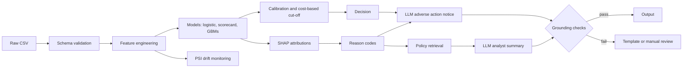

# Credit Risk Modeling: Two-Year Delinquency Prediction

[](https://github.com/sahandyousefi/Predicting-2-Year-Loan-Classification/actions/workflows/ci.yml)


This project estimates the probability that a borrower becomes 90 or more days past due within two years, and turns that estimate into a lending decision that can be explained, monitored and communicated. It started as an exploratory notebook on the Credit Risk Benchmark Dataset and is now a tested Python package with five model families, calibration and cost-based cut-offs, attribution-based reason codes, fairness and drift checks, a scoring API, and an LLM layer that drafts adverse action notices and analyst summaries under strict grounding checks.

## Contents

- [What the project does](#what-the-project-does)
- [Results](#results)
- [Architecture](#architecture)
- [Getting started](#getting-started)
- [Methodology](#methodology)
- [LLM decision support](#llm-decision-support)
- [Serving](#serving)
- [Testing and CI](#testing-and-ci)
- [Limitations](#limitations)
- [References](#references)

## What the project does

| Area | Implementation |
| --- | --- |
| Data | Schema validation with hard errors and soft warnings, synthetic data generator with the same schema for tests |
| Features | Ratio features, a weighted delinquency severity score, log transforms, Weight of Evidence binning with Information Value, dense embeddings of loan-purpose text (LSA or Sentence-BERT) |
| Models | L1 logistic regression, WoE scorecard with points scaling, histogram gradient boosting, XGBoost, LightGBM, optional monotonic constraints on the boosting models |
| Tuning | Optuna (TPE) with nested cross-validation to separate selection from evaluation |
| Evaluation | ROC-AUC, Gini, KS, PR-AUC, lift and gain tables, DeLong test, Brier score, ECE, Hosmer-Lemeshow, stratified bootstrap intervals for every reported metric, out-of-time validation by application month |
| Decisions | Profit-maximizing cut-off from PD, LGD, EAD and margin |
| Explainability | Exact linear SHAP and TreeSHAP, reason codes grouped to borrower attributes, PDP and ICE |
| Fairness | Approval rates, disparate impact and equal opportunity difference by age band |
| Monitoring | PSI and characteristic stability, champion-challenger tests with swap-set analysis, run fingerprints, MLflow tracking with a JSON fallback |
| Serving | Batch scoring CLI, FastAPI service with request validation, Dockerfile |
| LLM | Provider-agnostic client, versioned prompts, grounded adverse action notices, retrieval over credit policy, evaluation harness, prompt injection screening |

## Results

### Exploration notebook (benchmark data)

`notebooks/01_exploration_and_baseline.ipynb` documents the original analysis. Logistic regression on the raw attributes reached ROC-AUC 0.73. Adding engineered features raised it to 0.835 on the held-out test set:

| Model | Accuracy | Precision | Recall | F1 | ROC-AUC |
| --- | --- | --- | --- | --- | --- |
| Logistic regression, raw features | 0.66 | 0.68 | 0.60 | 0.64 | 0.73 |
| Logistic regression, engineered features | 0.760 | 0.759 | 0.760 | 0.760 | 0.835 |

The notebook fitted the scaler on the full dataset before splitting. The package moves scaling inside the pipeline, so these figures are a reference point rather than the final estimate.

### Package pipeline

Results to be filled from a full run on the benchmark data with `credit-risk train` and `credit-risk compare`. The comparison table reports discrimination, calibration, DeLong p-values against the best model and realized profit at the chosen cut-off.

### Text embedding ablation (synthetic data)

The table below comes from synthetic data only: 5,000 generated borrowers with generated purpose text, 16 LSA components, 5-fold cross-validation repeated twice. It checks that the ablation detects incremental signal when the generator puts it there and finds none when $\gamma = 0$. It says nothing about the value of text on real applications.

| Signal $\gamma$ | Learner | AUC, structured | AUC, structured + text | Gain | Corrected $t$-test p |
| --- | --- | --- | --- | --- | --- |
| 0.0 | Logistic | 0.732 | 0.731 | -0.001 | 0.54 |
| 0.0 | HistGBM | 0.710 | 0.708 | -0.002 | 0.58 |
| 0.5 | Logistic | 0.732 | 0.756 | 0.024 | < 0.001 |
| 0.5 | HistGBM | 0.710 | 0.745 | 0.035 | < 0.001 |
| 1.0 | Logistic | 0.732 | 0.839 | 0.106 | < 0.001 |
| 1.0 | HistGBM | 0.710 | 0.834 | 0.124 | < 0.001 |

Reproduce with `credit-risk text-ablation --n 5000 --dims 16 --seed 0`.

## Architecture



### Project structure

```
.
├── configs/default.yaml            split, model and cost parameters
├── data/README.md                  dataset source, dictionary and validation rules
├── docs/                           methodology, LLM design, model card
├── notebooks/                      exploration notebook
├── src/credit_risk/
│   ├── cli.py                      credit-risk command
│   ├── config.py                   typed YAML configuration
│   ├── data/                       schema, loader, synthetic generator
│   ├── features/                   engineered features, WoE binning
│   ├── models/                     pipelines, scorecard, registry, tuning, persistence
│   ├── evaluation/                 credit metrics, calibration, DeLong, thresholds, comparison
│   ├── explain/                    SHAP, reason codes, PDP/ICE, fairness
│   ├── monitoring/                 drift, experiment tracking
│   ├── serving/                    batch scoring, FastAPI service
│   └── llm/                        client, prompts, notices, retrieval, guardrails, evaluation
├── tests/                          unit and integration tests on synthetic data
├── Dockerfile
├── Makefile
└── pyproject.toml
```

## Getting started

```bash
git clone https://github.com/sahandyousefi/Predicting-2-Year-Loan-Classification.git
cd Predicting-2-Year-Loan-Classification
pip install -e ".[dev]"            # core package and test tools
pip install -e ".[gbm,tune,explain,serve]"   # optional model, tuning, SHAP and API extras
```

Download the dataset as described in `data/README.md`, then:

```bash
credit-risk validate "data/Credit Risk Benchmark Dataset.csv"
credit-risk train --config configs/default.yaml
credit-risk compare --models logistic scorecard hist_gbm xgboost lightgbm
credit-risk compare --models hist_gbm xgboost lightgbm --monotone
credit-risk compare --models logistic hist_gbm --n-boot 1000
credit-risk score applicants.csv scored.csv --model artifacts/model.joblib
credit-risk drift reference.csv current.csv --fail-on-drift
credit-risk challenge holdout.csv --champion prod.joblib --challenger new.joblib
credit-risk text-ablation --signals 0 0.5 1 --dims 8 16
credit-risk oot data.csv --cutoff 2020-07 --shift 1.0
```

`credit-risk synthesize data/synthetic.csv` writes a synthetic sample, which is enough to run every command without the real data.

## Methodology

This section summarizes the approach; [docs/methodology.md](docs/methodology.md) gives the notation, derivations, assumptions and references in full.

**Target and data.** `dlq_2yrs = 1` if the borrower was 90 or more days past due within two years. The benchmark has 16,714 borrowers and ten numeric attributes. Its default rate is far higher than in a production portfolio, which matters for calibration and cut-offs.

**Features.** Debt and income per household member, credit-to-income, a delinquency severity score $s = 1\cdot n_{30\text{-}59} + 2\cdot n_{60\text{-}89} + 3\cdot n_{90+}$ that replaces three counts with pairwise correlations near 0.99, and $\log(1+x)$ transforms of skewed amounts.

**Text features.** The benchmark has no text field, so `data/synthetic_text.py` attaches a short loan-purpose statement to each row. The purpose category $k$ is drawn with probability $\pi_k \propto p_k \exp\{\gamma\, s_k (2y-1)\}$, where $p_k$ is a prior share, $s_k$ a risk shift and $\gamma$ a signal strength; $\gamma = 0$ gives text that is independent of the outcome. `TextEmbedder` turns the text into $d$ dense features, either by TF-IDF on word unigrams and bigrams followed by truncated SVD (latent semantic analysis; Deerwester et al., 1990) or by Sentence-BERT embeddings reduced with PCA. The reduction is fitted inside the pipeline, so no test-fold vocabulary leaks into training. The ablation compares structured, text-only and combined feature sets on identical repeated $K$-fold splits. Fold AUC differences $d_j$ are tested with the corrected resampled $t$-statistic $t = \bar d \,/\, \sqrt{(1/J + n_{\text{test}}/n_{\text{train}})\, \hat\sigma_d^2}$ of Nadeau and Bengio (2003), because the usual paired $t$-test ignores the overlap between training sets and is anti-conservative.

**Scorecard.** Each attribute is binned on quantiles, adjacent bins are merged until the default rate is monotonic, and bins are encoded by Weight of Evidence $\mathrm{WoE}_i = \ln(g_i/G) - \ln(b_i/B)$. Information Value $\sum_i (g_i/G - b_i/B)\,\mathrm{WoE}_i$ ranks attributes. A logistic model on WoE values is scaled to points with $\text{score} = \text{offset} + \text{factor}\cdot\ln(\text{odds}_{good})$, $\text{factor} = \text{pdo}/\ln 2$ (Siddiqi, 2006).

**Model comparison.** All models are fitted on the same stratified split. ROC-AUC differences are tested with the DeLong et al. (1988) method for correlated ROC curves, using the fast midrank algorithm of Sun and Xu (2014). Hyperparameters are tuned with Optuna (Akiba et al., 2019) inside nested cross-validation, so the reported score is not inflated by model selection.

**Monotonic constraints.** The boosting models can be fitted with expected directions per input: PD non-decreasing in utilization, debt ratio and delinquency severity, non-increasing in age and income, and free for the others. The constraint is checked after fitting as the share of ICE curves that move in the wrong direction, which must be zero. This prevents reason codes that contradict credit judgment.

**Uncertainty.** `credit-risk compare --n-boot B` and the training report give a stratified bootstrap interval for every metric, including approval rate, bad rate and profit per applicant at a fixed cut-off. All models share the same resamples. Differences between models are still judged with paired tests, since overlapping intervals do not imply an insignificant difference.

**Calibration.** Probabilities are checked with the Brier score, expected calibration error and the Hosmer-Lemeshow test, and corrected with Platt scaling or isotonic regression on held-out data (Niculescu-Mizil and Caruana, 2005).

**Cut-off.** Approving a loan earns margin $m$ with probability $1-\mathrm{PD}$ and loses $\mathrm{LGD}$ with probability $\mathrm{PD}$, so with calibrated PDs the break-even cut-off is $\mathrm{PD}^* = m/(m+\mathrm{LGD})$. The package also searches the empirical profit curve, since PDs are never perfectly calibrated. LGD, EAD and margin are set in `configs/default.yaml` and are assumptions, not estimates.

**Explainability.** Linear models are explained in closed form, $\phi_j = \beta_j (x_j - \mathbb{E}[x_j])$, and tree ensembles with TreeSHAP (Lundberg and Lee, 2017). In both cases the attributions add up to the model's log-odds. Attributions of engineered features are summed back to the borrower attribute they come from, and the largest positive groups become up to four reason codes, as Regulation B requires for adverse action notices.

**Fairness.** Age is a model input and a protected basis. The fairness report gives approval rates, disparate impact against the most-approved band (four-fifths rule) and the difference in approval rates among borrowers who did not default (equal opportunity), with 62 and over as a separate band.

**Monitoring.** The Population Stability Index $\sum_i (a_i - e_i)\ln(a_i/e_i)$ is computed per input and on the score; values above 0.25 are flagged. Every training run records hashes of the configuration and data, library versions and the git commit.

**Out-of-time validation.** `credit-risk oot` fits the model on application months before a cut-off, keeps a random in-time holdout, and reports AUC with DeLong confidence intervals, Gini, KS and Brier score on the holdout and on all later months, together with the default rate, mean PD and AUC per month and the PSI of the score between development and out-of-time samples. Since the benchmark has no dates, `data/vintage.py` assigns synthetic months: at random when the drift parameter is zero, which makes the out-of-time sample exchangeable with the holdout, or ordered by a noisy rank of revolving utilization when it is positive, which imitates gradual population drift.

**Champion-challenger.** A candidate model replaces the production model only after a paired comparison on the same labeled out-of-sample applicants, each model at its own cut-off. Promotion requires three conditions: the DeLong lower confidence bound of $\mathrm{AUC}_{1}-\mathrm{AUC}_{0}$ above $-\delta_{\mathrm{AUC}}$ (non-inferiority), the paired bootstrap upper bound of the Brier score difference below $\delta_{B}$, and the bootstrap lower bound of the profit difference per applicant above zero. The swap-set table reports the bad rate of applicants the challenger would newly approve (swap-in) and newly decline (swap-out), which is how a policy change is usually explained to credit committees.

## LLM decision support

The LLM layer never makes or changes a credit decision. It writes text around a decision the model has already made, and every output is checked before use. [docs/llm_design.md](docs/llm_design.md) gives the architecture, validation rules, evaluation metrics and a failure-mode analysis.

- **Client.** One interface for any OpenAI-compatible endpoint, including local servers, plus a deterministic mock used in all tests. Retries with exponential backoff, and token, latency and cost logging. Configured with `LLM_PROVIDER`, `LLM_MODEL`, `LLM_BASE_URL` and `LLM_API_KEY`.
- **Prompts.** Stored as versioned YAML files. Each generation records the template fingerprint.
- **Adverse action notices.** The prompt lists only the model's reason codes. The reply must be valid JSON, cite exactly those codes in the same order, and avoid every prohibited basis under ECOA. If it fails after a retry, a deterministic template notice is used instead.
- **Analyst summaries.** Retrieval-augmented generation (Lewis et al., 2020) over a small credit policy written for this project. Policy sections are retrieved with a character n-gram TF-IDF retriever, or a Sentence-BERT retriever (Reimers and Gurevych, 2019) when the `embed` extra is installed. Any citation of a section that was not shown to the model is flagged.
- **Evaluation.** A fixed set of reason code combinations measures format compliance, grounding, hallucination and fallback rates for any provider. Retrieval is measured with recall@k and MRR on labeled queries; the TF-IDF retriever reaches recall@3 of 0.9 and MRR of 0.87 on the current set.
- **Guardrails.** Applicant free text is normalized, stripped of control characters and screened for instruction overrides, role changes, prompt extraction and delimiter attacks. Flagged text goes to manual review. The attack and benign examples in `llm/eval/injection_cases.yaml` serve as a regression set; they are not a measure of robustness against adaptive attacks.

## Serving

```bash
credit-risk train                        # writes artifacts/model.joblib
make serve                               # uvicorn on port 8000
curl -X POST localhost:8000/score -H "Content-Type: application/json" -d '{
  "rev_util": 0.95, "age": 29, "late_30_59": 3, "debt_ratio": 0.8, "monthly_inc": 2500,
  "open_credit": 12, "late_90": 2, "real_estate": 0, "late_60_89": 1, "dependents": 2}'
```

The response contains the PD, the decision at the stored cut-off and, for declines, the reason codes. `/score/batch`, `/health` and `/version` are also available. `make docker-build docker-run` runs the same service in a container with the model mounted from `artifacts/`.

## Testing and CI

```bash
make lint
make test
```

Tests run on synthetic data only and cover validation, features, every model family, metrics against reference implementations (for example KS against `scipy.stats.ks_2samp` and the DeLong AUC against scikit-learn), additivity of attributions, the API, and the LLM checks with mock providers. GitHub Actions runs lint and tests on Python 3.10 and 3.12. Tests that need optional extras are skipped when the extra is not installed.

## Limitations

- The benchmark has no application dates. Out-of-time validation is implemented and tested on synthetic vintages, but its results on the benchmark would only reflect the vintage generator, not real temporal stability.
- The default rate of the benchmark is far higher than in real portfolios; PDs must be recalibrated to the target default rate before pricing.
- LGD, EAD and margin in the configuration are illustrative.
- No protected attribute other than age is available, so proxy discrimination cannot be measured directly.
- The credit policy used for retrieval is illustrative and was written for this project.
- The loan-purpose text is synthetic. Any gain from text features measures the generator, not real applicants.

See [docs/methodology.md](docs/methodology.md) for the full statistical design, [docs/llm_design.md](docs/llm_design.md) for the LLM layer, [docs/model_card.md](docs/model_card.md) for the model card and [ROADMAP.md](ROADMAP.md) for planned work.

## References

- Akiba, T., Sano, S., Yanase, T., Ohta, T., and Koyama, M. (2019). Optuna: A next-generation hyperparameter optimization framework. *KDD*.
- Chen, T., and Guestrin, C. (2016). XGBoost: A scalable tree boosting system. *KDD*.
- Deerwester, S., Dumais, S. T., Furnas, G. W., Landauer, T. K., and Harshman, R. (1990). Indexing by latent semantic analysis. *Journal of the American Society for Information Science*, 41(6), 391-407.
- DeLong, E. R., DeLong, D. M., and Clarke-Pearson, D. L. (1988). Comparing the areas under two or more correlated receiver operating characteristic curves: A nonparametric approach. *Biometrics*, 44(3), 837-845.
- Efron, B., and Tibshirani, R. J. (1993). *An Introduction to the Bootstrap*. Chapman and Hall.
- Ke, G., Meng, Q., Finley, T., Wang, T., Chen, W., Ma, W., Ye, Q., and Liu, T.-Y. (2017). LightGBM: A highly efficient gradient boosting decision tree. *NeurIPS*.
- Lewis, P., et al. (2020). Retrieval-augmented generation for knowledge-intensive NLP tasks. *NeurIPS*.
- Lundberg, S. M., and Lee, S.-I. (2017). A unified approach to interpreting model predictions. *NeurIPS*.
- Mitchell, M., et al. (2019). Model cards for model reporting. *FAT\**.
- Nadeau, C., and Bengio, Y. (2003). Inference for the generalization error. *Machine Learning*, 52(3), 239-281.
- Niculescu-Mizil, A., and Caruana, R. (2005). Predicting good probabilities with supervised learning. *ICML*.
- Reimers, N., and Gurevych, I. (2019). Sentence-BERT: Sentence embeddings using Siamese BERT-networks. *EMNLP-IJCNLP*.
- Siddiqi, N. (2006). *Credit Risk Scorecards: Developing and Implementing Intelligent Credit Scoring*. Wiley.
- Sun, X., and Xu, W. (2014). Fast implementation of DeLong's algorithm for comparing the areas under correlated receiver operating characteristic curves. *IEEE Signal Processing Letters*, 21(11), 1389-1393.

## License

MIT. See [LICENSE](LICENSE).
