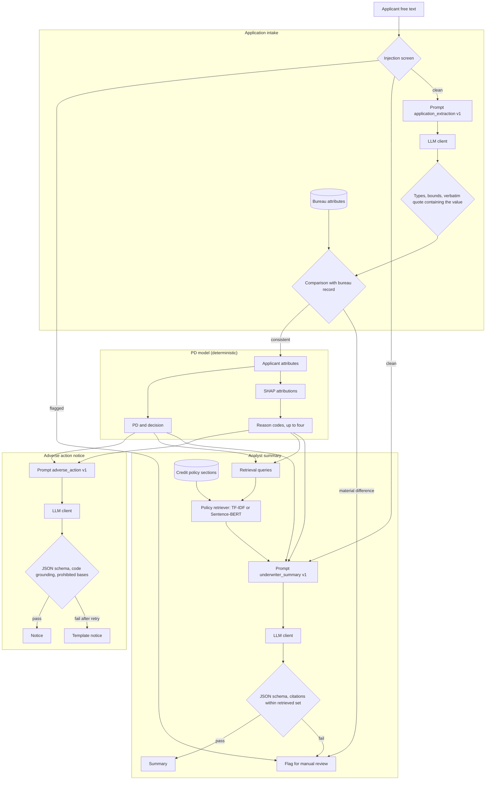

# LLM Layer Design

This document describes the design of `credit_risk.llm`: what the language model is allowed to do, how its inputs and outputs are controlled, and how its behaviour is measured. The statistical model is documented in [methodology.md](methodology.md).

## 1. Scope

The credit decision is made by the PD model and the cut-off. The LLM layer writes text around a decision that has already been made, for two readers:

- **Applicants** receive an adverse action notice that states the principal reasons for a decline in plain language.
- **Credit analysts** receive a short case summary that relates the model output to the relevant sections of the credit policy.
- **The intake process** receives structured fields read from a free-text application, for channels where applicants describe their situation in their own words.

The LLM never sees a decision it can change, never computes a number that is used downstream, and never sends text to a customer that has not passed deterministic validation. Extraction is the one place where the model's output becomes a model input, and there it may only copy a number the applicant wrote: every value must come with a verbatim quote that contains it. These constraints follow from treating the LLM as a component of a model in the sense of supervisory model risk guidance (Board of Governors of the Federal Reserve System, 2011): its output must be verifiable, its failure modes documented and its performance monitored.

## 2. Architecture

Every arrow into the LLM client carries only content the system produced or screened. Raw attribute values are not placed in the notice prompt; the model sees reason codes and their fixed descriptions.

## 3. Components

### 3.1 Client

`llm.client` defines one interface, `complete(system, user, temperature, json_mode)`, with three implementations:

| Implementation | Use |
| --- | --- |
| `MockLLM` | Deterministic responses from a function of the prompt. Used in every test, so CI needs no network or key. |
| `OpenAICompatibleLLM` | Any endpoint that implements the OpenAI chat completions API, including self-hosted servers. |
| `RetryingClient` | Wraps either of the above with exponential backoff ($\Delta t_k = \Delta t_0 \cdot 2^k$, up to three retries) and logs tokens, latency and estimated cost per call. |

The provider is chosen by `LLM_PROVIDER` (default `mock`); `LLM_MODEL`, `LLM_BASE_URL` and `LLM_API_KEY` configure a real endpoint. Keys are read from the environment only and are never written to logs or artifacts. Generation uses temperature zero so that repeated runs on the same input are as close to deterministic as the provider allows.

### 3.2 Prompts

Prompts are YAML files in `llm/prompts/` named `<name>_v<version>.yaml`, each with a system message, a user template with `$variable` placeholders and a description. Rendering fails if a variable is missing. The SHA-256 fingerprint of the template text (first twelve hex characters) is stored with every generation, so any output can be traced to the exact prompt that produced it. A prompt change is a new file and a new version, never an edit in place.

### 3.3 Adverse action notices

Regulation B requires a creditor that takes adverse action to provide a statement of the specific principal reasons (12 CFR 1002.9). The reasons come from the attribution-based reason codes described in the methodology; the LLM only rewrites them for a general reader.

A draft is accepted when all of the following hold:

1. The reply parses as a JSON object with the keys `summary`, `reasons` and `next_steps`.
2. Every item in `reasons` has a `code` and a `statement`, and the sequence of codes equals the model's reason codes in the same order. A code that the model did not produce is recorded as a hallucination.
3. No statement mentions a prohibited basis under the Equal Credit Opportunity Act (age, race, sex, marital status, religion, national origin, receipt of public assistance) or a term that would reveal one.

A failed draft is regenerated once. If the second draft also fails, a deterministic template built from the reason code descriptions is used and the fallback is recorded. An applicant therefore always receives a compliant notice, and the LLM can improve its wording but cannot introduce content.

### 3.4 Policy retrieval

The credit policy in `llm/policy/` is written for this project and is illustrative. It is split into one chunk per second-level section whose heading carries an identifier such as `POL-3`. Two retrievers share one interface:

- `TfidfRetriever` ranks chunks by cosine similarity of character 3- to 5-gram TF-IDF vectors with sublinear term frequency. Character n-grams make the match robust to inflection ("utilization", "utilized") without a stemmer.
- `EmbeddingRetriever` ranks chunks by cosine similarity of normalized Sentence-BERT embeddings (Reimers and Gurevych, 2019) and is available with the `embed` extra.

For a case, one query is built from the decision and all reason descriptions, and one query from each reason description alone. The union of the top two hits per query, in order of first appearance, is passed to the prompt. This favours coverage of every reason over the precision of a single query.

### 3.5 Analyst summary

The summary follows the retrieval-augmented generation pattern (Lewis et al., 2020). The prompt contains the PD, the decision, the reason codes and the retrieved policy excerpts with their identifiers, and asks for a JSON object with a summary, a list of cited excerpt identifiers and a recommendation in {approve, decline, refer}. The output is rejected if any identifier cited in the list or in the summary text in square brackets was not among the excerpts shown to the model, or if the recommendation is outside the allowed set. A rejected summary is not repaired; the case is flagged so that an analyst reads the model output directly.

### 3.6 Guardrails for applicant text

Any free text supplied by an applicant is untrusted input that may be placed in a prompt, which makes the system exposed to direct and indirect prompt injection (Perez and Ribeiro, 2022; Greshake et al., 2023). Before use, text is normalized to Unicode NFKC, stripped of control characters, whitespace-collapsed and truncated to 500 characters. It is then screened with patterns for five attack families: instruction override, role change, prompt extraction, attempts to steer the decision, and chat-template delimiters. Flagged text is not sent to the model and the case goes to manual review.

Pattern screening is a first line of defence with known limits. It catches common phrasings and is easy to audit, but an adaptive attacker can paraphrase around it. The structural controls carry more weight: the LLM has no tools, no access to the decision, and every output is validated against data the system already holds.

### 3.7 Field extraction from application text

`llm.extraction` reads eleven fields from a free-text application: age, monthly income, monthly debt payments, dependents, open credit lines, real estate loans, revolving utilization, the three delinquency counts, and the loan purpose as one of the categories in `data/synthetic_text.py`. Each field has a type (whole number, monthly amount, percentage returned as a fraction, or category) and bounds. Prompt `application_extraction` v1 asks for a JSON object with a value and an exact supporting quote per field, null for both when the field is not stated, and tells the model that the application text is data rather than instructions.

A field is accepted only if (i) the value has the declared type and lies within bounds, (ii) the quote, after whitespace and case normalization, is a substring of the screened application text, and (iii) for numeric fields, the quote contains a number equal to the value after unit handling: thousands written as `k`, currency symbols and separators, percentages, and number words from zero to twelve including "once", "twice" and "never". A field that fails any check is set to null and listed with the reason; the application is then routed to review. Field failures are not retried, because a second sample from the same prompt would hide rather than resolve the disagreement. Only a reply that is not valid JSON with a `fields` object is retried once. The application text passes the injection screen of Section 3.6 first, with a 2,000 character limit, and flagged text is never sent.

Accepted fields map to the benchmark attributes, with the debt ratio computed as monthly debt payments over monthly income. The model never computes the ratio itself.

`llm.extraction_baseline` implements a rule-based extractor that classifies clauses by keywords and returns the same JSON structure. It is the reference point for the LLM in the evaluation and serves as the deterministic mock in tests.

### 3.8 Consistency with the bureau record

An accepted extraction shows that the applicant wrote a value, not that it is true. `llm.consistency` compares each extracted field with the same attribute on the bureau record: age, monthly income, monthly debt payments (the bureau debt ratio times the income on file), revolving utilization, the three delinquency counts, open credit lines, real estate loans and dependents. A difference within tolerance is consistent: one year for age, 10% of the bureau value for income, 20% for debt payments, ten percentage points for utilization, and none for counts. A larger difference is classified by direction. It is material when it lowers the applicant's apparent risk (income above, debt payments, utilization or delinquencies below the bureau value, or any difference in age) and informational otherwise. Each material finding carries a code such as `INCOME_OVERSTATED`, and any material finding sends the application to review.

The bureau is the system of record. The reconciled model inputs take the bureau value when one exists and the stated value only to fill a gap, so a misstatement or an extraction error cannot change the PD of an applicant with a complete bureau file. The same comparison catches the residual risk of Section 3.7, a correct number attached to the wrong field, when the field it lands in is on file.

## 4. Evaluation

Evaluation runs offline on fixed case sets stored in `llm/eval/`, so the same numbers can be computed for any provider and compared across prompt versions.

**Notices.** For a set of reason code combinations, the harness reports

| Metric | Definition |
| --- | --- |
| Format compliance | Share of cases whose final draft parsed as JSON |
| Grounded rate | Share of cases accepted without fallback |
| First-try rate | Share accepted on the first attempt |
| Hallucination rate | Share of cases whose final rejected draft cited a code the model did not produce |
| Prohibited term rate | Share of cases whose final rejected draft mentioned a prohibited basis |
| Fallback rate | Share of cases that ended with the template notice |

together with token usage, latency and estimated cost from the usage log.

**Retrieval.** For labeled queries $q$ with relevant section set $\mathcal{R}_q$ and ranked results $r_{q,1}, r_{q,2}, \dots$,

$$\mathrm{recall@}k = \frac{1}{|Q|}\sum_{q} \frac{\lvert \{r_{q,1},\dots,r_{q,k}\} \cap \mathcal{R}_q \rvert}{\lvert \mathcal{R}_q \rvert}, \qquad \mathrm{MRR} = \frac{1}{|Q|}\sum_q \frac{1}{\operatorname{rank}_q},$$

where $\operatorname{rank}_q$ is the position of the first relevant section, with $1/\operatorname{rank}_q = 0$ when none is retrieved (Manning et al., 2008). On the current query set the TF-IDF retriever reaches recall@3 of 0.9 and MRR of 0.87. The query set is small and written by the same author as the policy, so these figures check the retriever for regressions; they are not an estimate of performance on a real policy library.

**Extraction.** `data/synthetic_applications.py` writes first-person applications from synthetic borrowers with known field values. Each field is omitted with a fixed probability, stated with one of three phrasings per field, and mixed with distracting numbers such as job tenure, rent and the requested amount. A share of stated fields uses the last phrasing in each list, which avoids the keywords of the rule-based baseline. For field $f$, with $S_f$ the applications that state it and $\bar S_f$ those that do not,

| Metric | Definition |
| --- | --- |
| Accuracy | Share of $S_f$ with an accepted value equal to the gold value |
| Missed | Share of $S_f$ returned as null, including rejected values |
| Wrong | Share of $S_f$ with an accepted but incorrect value |
| Hallucinated | Share of $\bar S_f$ with an accepted value |

Integers must match exactly, amounts within half a dollar and fractions within 0.005. The summary adds micro-averaged accuracy, the share of applications with every field correct, and the review rate. On these texts the rule-based baseline is exact on the phrasings it covers and misses the others. The quote check removes fabricated values but not misattributed ones: a number taken from the sentence about open credit lines and reported as the number of dependents passes, which is why extracted fields are compared with bureau attributes before use.

**Consistency.** `make_applications(misstatement_rate=...)` lets a share of applicants misstate one field in their favour: income raised by 30% to 80%, debt payments or utilization cut by 40% to 70%, or past delinquencies denied. The bureau attributes keep the true values, and honest applications are generated from a separate random stream so they are identical for any misstatement rate. The study reports, by misstatement type, the share of applications flagged with the matching code, and for honest applications the share flagged for any reason. Honest applicants in the generator state bureau values exactly, so false alarms here measure extraction errors only; on real data, rounding and recall errors by honest applicants make the tolerances a trade-off between false alarms and missed misstatements.

**Guardrails.** The injection set contains attack strings and benign applicant statements. The harness reports the detection rate on attacks and the false positive rate on benign text. Because the attacks are known in advance, a high detection rate shows that the patterns work as intended, not that the screen is robust.

## 5. Failure modes and controls

| Failure mode | Control | Residual risk |
| --- | --- | --- |
| Invented reason in a notice | Code sequence must equal the model's reason codes; template fallback | None for codes; wording of a statement can still be imprecise |
| Reference to a prohibited basis | Pattern check on every statement; template fallback | Indirect references not covered by the term list |
| Malformed output | JSON parsing and key checks; one retry | Higher fallback rate for weaker models |
| Unsupported policy claim in a summary | Citations restricted to retrieved identifiers | Uncited sentences are not verified against the excerpts |
| Prompt injection through applicant text | Sanitization, pattern screen, manual review | Paraphrased attacks; mitigated by the lack of tools and decision access |
| Extracted value not written by the applicant | Verbatim quote required and checked against the text; quote must contain the value | A misread quote, for example a count attached to the wrong delinquency bucket, passes when the number appears in it |
| Misstated or misattributed field | Comparison with the bureau record; bureau values take precedence in model inputs | Fields without a bureau counterpart, such as the loan purpose, are not verified |
| Silent prompt drift | Versioned prompt files and fingerprints on every output | None when fingerprints are monitored |
| Provider outage or rate limit | Exponential backoff; template notices need no LLM | Summaries are unavailable during an outage |
| Data leakage to a third-party endpoint | Notice prompts contain codes, not attribute values; self-hosted endpoints supported | Summaries include the PD and reason descriptions |

## 6. Monitoring in production

The quantities in Section 4 become monitoring metrics when computed on live traffic: fallback rate, hallucination rate and prohibited term rate per prompt version and provider, the share of summaries flagged for review, the share of applicant texts blocked by the screen, and token cost per case. A rise in any of them after a provider or prompt change is a reason to roll back to the previous version, which the fingerprints make possible.

## 7. Limitations

- The policy corpus, the evaluation sets and the injection examples are small and written for this project.
- Checks verify structure and grounding of identifiers, not the factual accuracy of every sentence. A sentence can cite the right section and still misstate it.
- The prohibited-basis check is lexical. It is a necessary control, not a sufficient one, and does not replace compliance review of the prompt and template text.
- No human evaluation of readability or tone has been carried out.

## References

- Board of Governors of the Federal Reserve System (2011). *Supervisory Guidance on Model Risk Management*, SR Letter 11-7.
- Code of Federal Regulations, Title 12, Part 1002 (Regulation B, Equal Credit Opportunity Act), Section 1002.9, Notifications.
- Greshake, K., Abdelnabi, S., Mishra, S., Endres, C., Holz, T., and Fritz, M. (2023). Not what you've signed up for: Compromising real-world LLM-integrated applications with indirect prompt injection. *Proceedings of the 16th ACM Workshop on Artificial Intelligence and Security*, 79-90.
- Lewis, P., Perez, E., Piktus, A., Petroni, F., Karpukhin, V., Goyal, N., Kuttler, H., Lewis, M., Yih, W., Rocktaschel, T., Riedel, S., and Kiela, D. (2020). Retrieval-augmented generation for knowledge-intensive NLP tasks. *Advances in Neural Information Processing Systems*, 33.
- Manning, C. D., Raghavan, P., and Schutze, H. (2008). *Introduction to Information Retrieval*. Cambridge University Press.
- Perez, F., and Ribeiro, I. (2022). Ignore previous prompt: Attack techniques for language models. *NeurIPS ML Safety Workshop*.
- Reimers, N., and Gurevych, I. (2019). Sentence-BERT: Sentence embeddings using Siamese BERT-networks. *Proceedings of EMNLP-IJCNLP*, 3982-3992.
